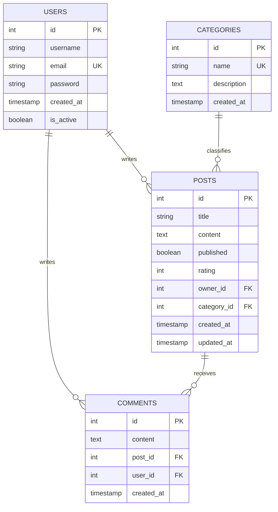

# 📰 HAGUE — Modern Editorial & News Magazine (Blog Platform)

> **24-loyiha:** **FastAPI**, **PostgreSQL** va **Bootstrap 5.3.3** asosida qurilgan to'liq funksional, xavfsiz va zamonaviy Blog Backend API hamda unga to'liq moslashtirilgan interaktiv Frontend.

---

## 🌟 Asosiy Xususiyatlar va Imkoniyatlar

- 🔐 **Autentifikatsiya & Foydalanuvchilar (JWT & Bcrypt):**
  - Ro'yxatdan o'tish (`POST /api/auth/register`) va tizimga kirish (`POST /api/auth/login`).
  - Foydalanuvchi profilini olish (`GET /api/auth/me`).
- 📝 **Maqolalar (Posts CRUD & Nashr qilish):**
  - Yangi maqola yaratish (`POST /api/posts`).
  - Maqolalar ro'yxatini olish, saralash va sahifalash (`GET /api/posts`).
  - Maqolani batafsil ko'rish va unga bog'liq barcha izohlarni yuklash (`GET /api/posts/{id}`).
  - Maqolani tahrirlash (`PUT /api/posts/{id}`) — faqat maqola muallifi uchun.
  - Maqolani o'chirish (`DELETE /api/posts/{id}`) — faqat maqola muallifi uchun.
- 💬 **Izohlar Tizimi (Interactive Comments):**
  - Maqolaga izoh qo'shish (`POST /api/posts/{id}/comments`).
  - Maqolaning barcha izohlarini ko'rish (`GET /api/posts/{id}/comments`).
  - Izohni o'chirish (`DELETE /api/comments/{id}`) — izoh muallifi yoki maqola egasi uchun.
- 🏷️ **Kategoriyalar (Categories):**
  - Yangi kategoriya qo'shish (`POST /api/categories`).
  - Barcha kategoriyalar va ulardagi maqolalar sonini ko'rish (`GET /api/categories`).
  - Kategoriya bo'yicha maqolalarni filtrlash (`GET /api/posts?category_id=...`).
- 🔍 **Qidiruv (Instant Search):**
  - Maqola sarlavhasi va matni bo'yicha jonli qidiruv (`GET /api/posts?search=...`).
- 👤 **Foydalanuvchi Maqolalari:**
  - Istalgan foydalanuvchining maqolalarini ko'rish (`GET /api/users/{id}/posts`).
  - Tizimga kirgan foydalanuvchining barcha maqolalarini ko'rish (`GET /api/users/me/posts`).

---

## 🛠 Texnologiyalar Staki

| Qatlam | Texnologiyalar |
| :--- | :--- |
| **Backend Framework** | `FastAPI` (Python 3.12, Uvicorn ASGI) |
| **Ma'lumotlar Bazasi** | `PostgreSQL` (`blog_db`), `SQLAlchemy 2.0 ORM` |
| **Autentifikatsiya** | `JWT (python-jose)`, `Bcrypt (xavfsiz hashing)` |
| **Validatsiya** | `Pydantic v2`, `Email-Validator` |
| **Frontend UI** | `Bootstrap 5.3.3`, `Bootstrap Icons`, `Vanilla JavaScript (Fetch API)` |
| **Testlash** | `Pytest`, `HTTPX TestClient` |

---

## 📡 API Endpoints Jadvali

| Method | Endpoint | Tavsif | Autentifikatsiya |
| :--- | :--- | :--- | :---: |
| `POST` | `/api/auth/register` | Yangi foydalanuvchini ro'yxatdan o'tkazish | ❌ |
| `POST` | `/api/auth/login` | Tizimga kirish va JWT access token olish | ❌ |
| `GET` | `/api/auth/me` | Tizimga kirgan foydalanuvchi ma'lumotlari | ✅ |
| `GET` | `/api/posts` | Maqolalar ro'yxati (filter, search, pagination) | ❌ |
| `POST` | `/api/posts` | Yangi maqola chop etish | ✅ |
| `GET` | `/api/posts/{id}` | Maqola tafsilotlari va uning izohlari | ❌ |
| `PUT` | `/api/posts/{id}` | Maqolani tahrirlash (faqat muallif) | ✅ |
| `DELETE`| `/api/posts/{id}` | Maqolani o'chirish (faqat muallif) | ✅ |
| `GET` | `/api/posts/{id}/comments` | Maqola izohlarini ko'rish | ❌ |
| `POST` | `/api/posts/{id}/comments` | Maqolaga yangi izoh qoldirish | ✅ |
| `DELETE`| `/api/comments/{id}` | Izohni o'chirish (izoh muallifi/post egasi) | ✅ |
| `GET` | `/api/categories` | Barcha kategoriyalar ro'yxati | ❌ |
| `POST` | `/api/categories` | Yangi kategoriya qo'shish | ✅ |
| `GET` | `/api/categories/{id}` | Kategoriya tafsilotlari | ❌ |
| `GET` | `/api/users/me/posts` | Hozirgi foydalanuvchining maqolalari | ✅ |
| `GET` | `/api/users/{id}/posts`| Muayyan foydalanuvchining maqolalari | ❌ |
| `GET` | `/api/users/{id}` | Foydalanuvchi profili | ❌ |

---

## 🗄 Ma'lumotlar Bazasi Modeli (PostgreSQL)



---

## 🚀 Loyihani Ishga Tushirish

### 1. Avtomatik ishga tushirish (Tavsiya etiladi):
```bash
cd 24-blog
./start.sh
```

### 2. Qo'lda ishga tushirish:
```bash
cd 24-blog/backend

# Virtual muhit yaratish va kutubxonalarni o'rnatish
python3 -m venv venv
./venv/bin/pip install -r requirements.txt

# Namunaviy ma'lumotlarni bazaga yuklash
./venv/bin/python3 seed.py

# Serverni ishga tushirish
./venv/bin/python3 run.py
```

Server ishga tushgach:
- **API Hujjatlari (Swagger):** `http://127.0.0.1:8000/docs`
- **ReDoc:** `http://127.0.0.1:8000/redoc`
- **Frontend Sayt:** Brauzerda `24-blog/index.html` ni oching yoki `http://127.0.0.1:8000/static/index.html` orqali kiring.

---

## 🧪 Avtomatlashtirilgan Testlarni O'tkazish

Barcha 13 ta API talablari bo'yicha to'liq test sinovlarini o'tkazish:

```bash
cd 24-blog
./backend/venv/bin/pytest backend/tests -v
```

---

## 🔗 Alohida GitHub Repozitoriya
- GitHub: [https://github.com/shamsiyevshamsiddin19/blog](https://github.com/shamsiyevshamsiddin19/blog)
